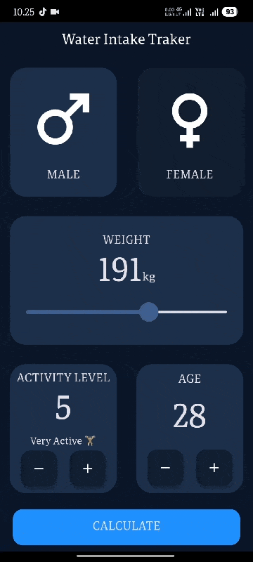

# 💧 Water Calculator App

A beginner-level Flutter application built to practice the fundamentals of **Flutter and Dart**.

This is one of my first Flutter projects, focused on understanding how to build a multi-screen app, collect user input, process data, and display a result using reusable Flutter widgets.

## 📱 About the Project

The app takes user input and processes it to provide a calculated result related to water intake.

The main purpose of this project is **learning and practice**, rather than building a production-ready application.

Through this project, I practiced:

* Flutter UI development
* User input handling
* Stateful widgets
* Screen navigation
* Reusable widgets
* Dart classes and methods
* Separating UI and logic
* Basic project structure
* Working with constants
* Building a simple calculation-based application

## ✨ Features

* User-friendly input screen
* Input fields and controls
* Calculation based on user information
* Separate result screen
* Reusable UI components
* Simple and clean Flutter interface
* Basic validation and user interaction

## 🛠️ Technologies Used

* **Flutter**
* **Dart**
* Material Design
* Android Studio / VS Code
* Git & GitHub

## 📂 Project Structure

```text
lib/
│
├── components/
│   ├── bottom_button.dart
│   ├── icon_content.dart
│   ├── reusable_card.dart
│   └── round_icon.dart
│
├── screens/
│   ├── input_page.dart
│   └── result_page.dart
│
├── constants.dart
├── main.dart
└── water_brain.dart
```

### Main Files

**`main.dart`**

The entry point of the Flutter application.

**`input_page.dart`**

Contains the main user input interface.

**`result_page.dart`**

Displays the calculated result to the user.

**`water_brain.dart`**

Contains the calculation/business logic used by the application.

**`constants.dart`**

Contains reusable constant values used throughout the application.

**`components/`**

Contains reusable UI widgets to avoid repeating the same interface code.

## 🧠 What I Learned

While building this project, I practiced several important Flutter concepts:

### Flutter Widgets

Learned how Flutter's widget-based UI system works and how different widgets can be combined to create an application interface.

### Stateful Widgets

Used state to handle changes caused by user interaction.

### User Input

Practiced collecting information from the user and using that information in calculations.

### Navigation

Learned how to move from one screen to another and pass calculated information to the result screen.

### Reusable Widgets

Created reusable components such as cards, buttons, icons, and other UI elements instead of writing the same UI repeatedly.

### Separating Logic

Created a separate `water_brain.dart` file for calculation logic instead of putting all logic directly inside the UI.

This helped me understand the basic idea of separating **UI from application logic**.

## 🎯 Purpose

This project is part of my journey to become a **Flutter Mobile App Developer**.

The goal was not to create a complex application, but to strengthen my understanding of Flutter fundamentals by building something functional from start to finish.

## 🚀 Getting Started

### Prerequisites

Make sure you have installed:

* Flutter SDK
* Dart SDK
* Android Studio or VS Code
* Android Emulator or a physical Android device

### Run the Project

Clone the repository:

```bash
git clone YOUR_REPOSITORY_URL
```

Move into the project directory:

```bash
cd YOUR_PROJECT_FOLDER
```

Get the dependencies:

```bash
flutter pub get
```

Run the application:

```bash
flutter run
```

## 📸 Screenshots
<p align="center">

</p>

## 🔮 Future Improvements

As I continue learning Flutter, I plan to improve this project by adding:

* Better input validation
* Improved UI/UX
* More accurate calculations
* Unit selection
* Better error handling
* Local data storage
* Improved responsive design
* More detailed results

## 📚 Learning Source

This project was built as part of my Flutter learning journey while practicing concepts from Flutter/Dart tutorials and documentation.

The project was modified and implemented as a personal learning exercise rather than being presented as a production application.

## 👨‍💻 Author

**Sheeraz Ahmed**

Computer Science Student
Learning Flutter & Dart

---

⭐ This project represents one step in my journey from learning Flutter fundamentals toward building complete applications independently.
